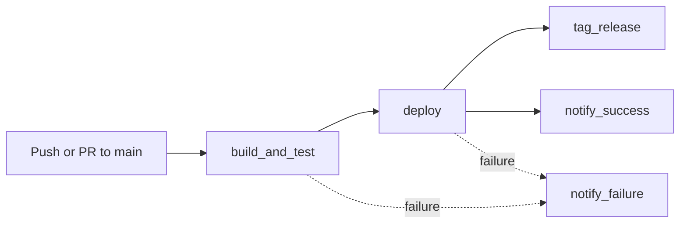

# Blog App: CI/CD Pipeline

[](https://github.com/ccajr/fso-cicd/actions/workflows/pipeline.yml)

A full stack blog application with an automated GitHub Actions pipeline that lints, tests, builds, deploys, versions, and reports on every change.

I built it for [Full Stack Open](https://fullstackopen.com/en/) Part 11 (Continuous Integration) from the University of Helsinki.

**Live demo:** https://fso-cicd-yvw8.onrender.com

## Pipeline



All jobs are defined in [`.github/workflows/pipeline.yml`](.github/workflows/pipeline.yml).

| Job | What it does |
|---|---|
| `build_and_test` | Installs dependencies, lints the client and server, runs unit and API tests, builds the client, and runs Playwright end-to-end tests in Chromium. |
| `deploy` | Calls a Render deploy hook to release the new version. |
| `tag_release` | Bumps the patch version and pushes a Git tag, such as `0.0.2`. |
| `notify_success` | Posts the deployed commit's details to Discord. |
| `notify_failure` | Posts a Discord alert with links to the commit and the failed workflow run. |

### Rules

- Every push to `main` runs the full pipeline. Every pull request to `main` runs `build_and_test` when it's opened or updated.
- Only pushes are deployed, tagged, and announced. Pull requests are tested but never deployed.
- To skip deployment and tagging, add `#skip` to a commit message. The build and tests still run.
- Each stage needs the previous one to pass. A failing lint, test, or build blocks the release.

## Tech stack

| Area | Tools |
|---|---|
| Front end | React 19, Vite, React Router, TanStack Query, Material UI |
| Back end | Node.js, Express 5, MongoDB with Mongoose, JWT, bcrypt |
| Testing | Vitest and React Testing Library for the client, `node:test` and Supertest for the API, Playwright for end-to-end tests |
| CI/CD | GitHub Actions, Render, Discord webhooks |

## Features

- Users log in with token-based authentication, and the session persists across reloads. Accounts are created through the API.
- Logged-in users can create blogs, like them, and comment on them.
- Only the user who created a blog can delete it.
- The app includes user pages that list each user's blogs.

### API

| Method | Endpoint | Auth | Description |
|---|---|---|---|
| GET | `/api/blogs` | | List blogs with their users and comments |
| POST | `/api/blogs` | ✔ | Create a blog |
| PUT | `/api/blogs/:id` | ✔ | Update a blog, for example to add likes |
| DELETE | `/api/blogs/:id` | ✔ | Delete a blog (creator only) |
| POST | `/api/blogs/:id/comments` | ✔ | Add a comment |
| GET | `/api/users` | | List users and their blogs |
| POST | `/api/users` | | Create a user |
| POST | `/api/login` | | Log in and receive a token |
| GET | `/health` | | Health check |
| GET | `/version` | | App version |

## Project structure

```
.
├── .github/workflows/pipeline.yml   # CI/CD pipeline
├── client/                          # React + Vite front end, with Vitest tests
├── server/                          # Express API, Mongoose models, and API tests
├── e2e-tests/                       # Playwright end-to-end tests
├── playwright.config.js
├── build_step.sh                    # Installs dependencies and builds the client
└── package.json                     # Root scripts: dev, build, start, test:e2e
```

## Running locally

**Prerequisites:** Node.js 24 (the version CI uses) and a MongoDB database, such as MongoDB Atlas.

1. Create `server/.env`:

   ```
   MONGODB_URI=<development database URI>
   TEST_MONGODB_URI=<separate test database URI>
   SECRET=<any random string for signing JWTs>
   PORT=3003
   ```

2. Install dependencies:

   ```bash
   npm install
   npm install --prefix client
   npm install --prefix server
   ```

3. Start the client and server together:

   ```bash
   npm run dev
   ```

   Vite serves the client on http://localhost:5173 and sends `/api` requests to the server on port 3003.

### Tests

```bash
npm run lint --prefix client
npm run lint --prefix server
npm test --prefix client
npm test --prefix server
npx playwright install
npm run test:e2e
```

- **Server tests** use `TEST_MONGODB_URI`.
- **End-to-end tests** start both servers automatically. The backend runs in test mode, which turns on a `/api/testing/reset` endpoint to clear the test database.

### Production build

```bash
npm run build
npm start
```

In production, Express serves the built client from `client/dist`.

## Deployment

The app runs on [Render](https://render.com). The service settings are kept in Render, not in this repo:

- **Build command:** `./build_step.sh` <!-- TODO: confirm -->
- **Start command:** `npm start` <!-- TODO: confirm -->
- **Environment:** `MONGODB_URI` and `SECRET`
- **Auto-deploy:** off, so only the pipeline's deploy hook triggers deploys <!-- TODO: confirm -->.

### Repository secrets

Set these under **Settings → Secrets and variables → Actions**:

| Secret | Used by |
|---|---|
| `TEST_MONGODB_URI` | API and end-to-end tests |
| `SECRET` | API and end-to-end tests (JWT signing) |
| `RENDER_DEPLOY_HOOK` | `deploy` |
| `DISCORD_WEBHOOK` | `notify_success` and `notify_failure` |

`GITHUB_TOKEN` is provided automatically and is used by `tag_release`.

## Acknowledgements

This project was built as coursework for [Full Stack Open](https://fullstackopen.com/en/) from the University of Helsinki, and I earned the Part 11 Continuous Integration certificate for it.
